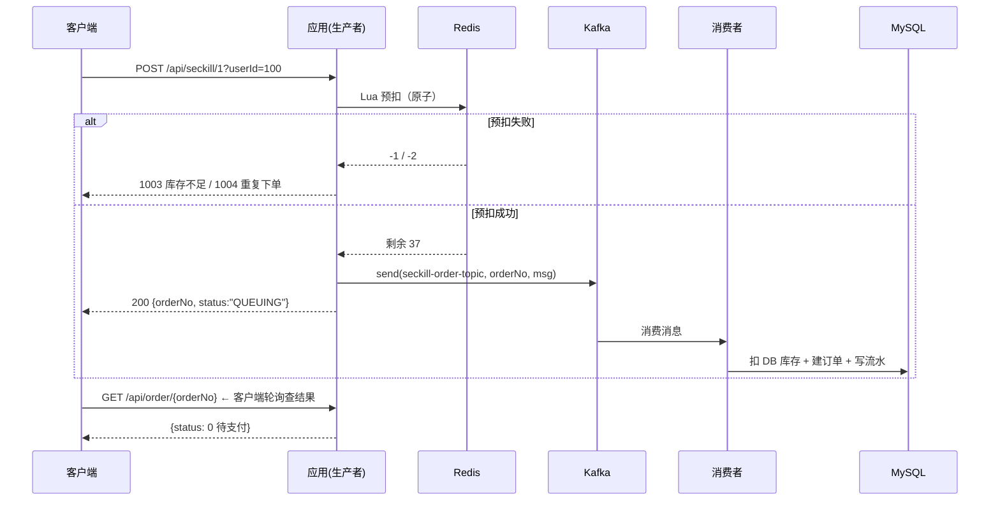

# seckill-lab 秒杀演进实验 — 设计文档

**日期：** 2026-09-20
**状态：** 待评审
**目标读者：** 项目作者本人（学习/实验用途）

---

## 0. 实验环境（本机原生安装，非 Docker）

中间件不走容器，而是在 Windows 本机原生安装，各自带启动/停止脚本：

| 组件 | 版本 | 安装目录 | 端口 | 启动 | 停止 |
|---|---|---|---|---|---|
| MySQL | 8.0.29 | `C:\Users\lsy1\mysql-8.0.29` | 3306 | `start-mysql.bat` | `stop-mysql.bat` |
| Redis | 5.0 | `C:\Users\lsy1\redis` | 6379 | `start-redis.bat` | `stop-redis.bat` |
| Kafka | 4.3.1 | `C:\Users\lsy1\kafka` | 9092（PLAINTEXT）/ 9093（CONTROLLER） | `start-kafka.bat` | `stop-kafka.bat` |

- **MySQL**：`root` / `123456`，数据目录 `C:\Users\lsy1\mysql-data`，配置 `my.ini`（`innodb_buffer_pool_size=128M`、`performance_schema=OFF`、`max_connections=50`）
- **Redis**：无密码，`bind 127.0.0.1`，`appendonly no`（纯内存，重启丢数据）
- **Kafka**：KRaft 单节点（broker + controller），数据目录 `C:\Users\lsy1\kafka-data`，堆 `-Xmx256M`。**首次使用或删过 `kafka-data` 后，先跑一次 `init-kafka.bat` 格式化存储**，再 `start-kafka.bat`

后文命令行统一约定：

- MySQL 客户端 = `C:\Users\lsy1\mysql-8.0.29\bin\mysql.exe -uroot -p123456`
- Redis 客户端 = `C:\Users\lsy1\redis\redis-cli.exe`
- Kafka 工具 = `C:\Users\lsy1\kafka\bin\windows\*.bat`

> `docker-compose.yml` 保留为可选的容器化方案，但**当前实验默认走本机安装版**，后文命令均按本机版编写。

---

## 1. 背景与目标

`seckill-lab` 是一个 Spring Boot 4 + MyBatis-Plus + Redis + Kafka 的秒杀学习项目。当前工程骨架、统一响应/异常、分层规范已就绪，`goods` 示例模块可跑通，但**秒杀业务本身一行未写**。

本文档定义一套**分版演进路线**：同一个秒杀接口，用 7 个 Git tag 逐步加固，每一版针对一个具体的高并发病症，用 JMeter 压测拿数据横向对照，最终产出一份"哪个优化真的有用、收益多少、代价是什么"的实测报告。

### 1.1 成功标准

1. 7 个版本各有一份可复现的压测数据（QPS / P95 / P99 / 错误率 / 业务指标）
2. 每一版都能通过 SQL 对账脚本给出明确结论：**有没有超卖、有没有重复下单、库存是否守恒**
3. 故障注入（停 Redis / 停 Kafka）时能观察到明确的降级行为，而不是无声挂掉
4. 报告能回答："从 V0 到 V5，QPS 提升了几倍？每一版各自贡献了多少？代价是什么？"

### 1.2 非目标（明确不做）

- 不做前端页面（`static` / `templates` 保持为空，用 curl + JMeter 验证）
- 不做登录鉴权（`userId` 请求参数直传，见 §3.5）
- 不做分布式部署（单机单实例，避免引入分布式锁/一致性哈希等噪声变量）
- 不做真实支付对接（支付是状态机模拟，见 §6.5）
- 不追求生产级代码完备度（学习项目，优先"能跑出对照数据"而不是"封装优雅"）

---

## 2. 已敲定的设计决策

| # | 决策项 | 结论 | 影响 |
|---|---|---|---|
| D1 | 数据模型 | **按路线重建**：`goods` 保留为商品主表；新增 `user` / `seckill_activity` / `seckill_stock` / `seckill_order` / `stock_log`；删除旧的 `seckill_goods` | §4 全部 DDL |
| D2 | V0 基线行为 | **两条基线都留**：`v0a-naive`（无保护，会超卖 + 重复下单）+ `v0b-atomic`（原子扣减，不超卖） | §3.2、§5.1、§5.2 |
| D3 | 版本迭代方式 | **Git tag 逐版演进**，每版在前一版基础上改代码 | §3.3 |
| D4 | 压测工具 | **JMeter 5.6.3**（本机已装 `D:\develop\apache-jmeter-5.6.3`），CLI 非 GUI 模式 | §7 |
| D5 | 用户身份 | **请求参数直传 `userId`**，无鉴权开销 | §3.5 |
| D6 | 支付与关单 | **完整模拟**：`POST /api/pay` 乐观锁 + 定时任务扫超时单回补库存 | §6.5、§6.6 |
| D7 | 唯一约束时机 | **V0 不建业务唯一约束**，V1 用独立 SQL 文件 `schema-v1-constraints.sql` 添加 | §4.3 |
| D8 | 库存流水 | **V0 就开始写** `stock_log`，让阶段 10 对账能覆盖全部 7 版 | §5.1 |
| D9 | 压测规模 | 梯度 **100 / 200 / 500 / 1000** 并发，造 **10 万**用户 | §7.2 |
| D10 | 库存分桶 | **不纳入主线**，作为可选附录 | §11 |

---

## 3. 总体设计

### 3.1 为什么把库存独立成 `seckill_stock` 表

这是整个数据模型里最关键的一个决定，理由是它直接决定了后续优化的**可观测性**：

- **行锁竞争看得见**：V0 的瓶颈序列是 `Tomcat(200线程) → Hikari(20连接) → seckill_stock 单行锁`。库存独立成表后，热点就是一张窄表上的单行，锁等待可以直接从 `INNODB_TRX` / `performance_schema` 观察，也能干净地做"分桶"实验（附录 A）。
- **活动与库存生命周期不同**：活动信息（价格、时间）是**读多写少**，适合 V4 上缓存；库存是**写热点**，永远不该被缓存成"真相源"。放在同一张表里会逼着你在 V4 拆分，不如一开始就分开。
- **对账基准明确**：`seckill_activity.total_stock`（不可变）与 `seckill_stock.stock`（可变）分离，任何时刻都能算出"应该卖了多少"。

### 3.2 两条 V0 基线的必要性

单条 V0 基线无法把两个独立病症分开：

| 病症 | 成因 | 需要哪条基线才能暴露 |
|---|---|---|
| **超卖**（卖出 > 库存） | `UPDATE stock = stock - 1` 缺少 `WHERE stock >= 1` | V0a |
| **重复下单**（一人多单） | 无幂等保护（V0 阶段无唯一约束、无 Redis 去重） | V0a **和** V0b 都有 |

所以：

- `v0a-naive` → 同时暴露 **超卖 + 重复下单**
- `v0b-atomic` → 只暴露 **重复下单**（超卖被 `WHERE stock >= 1` 挡住）

有了这两条基线，V1 的每个改进点（Redis+Lua 预扣 → 治超卖与性能；唯一索引 + setnx → 治重复下单）都能**单独归因**，而不是笼统地说"V1 变好了"。

### 3.3 版本演进与 Git tag

```
阶段0 收尾 ──► tag: stage0-env
                    │
   ┌────────────────┴────────────────┐
   ▼                                 ▼
tag: v0a-naive  ─────────────►  tag: v0b-atomic
(无条件扣减，会超卖)              (原子扣减，不超卖)
   │                                 │
   └────────────────┬────────────────┘
                    ▼
            tag: v1-redis-lua      Redis 预热 + Lua 原子预扣 + DB 唯一索引兜底
                    ▼
            tag: v2-kafka          Lua 预扣 → Kafka → 消费者异步落库
                    ▼
            tag: v3-consistency    支付乐观锁 + 超时关单回补 + 幂等消费 + 消息可靠
                    ▼
            tag: v4-cache          Caffeine + Redis 二级缓存（活动详情）
                    ▼
            tag: v5-ratelimit      Redis 滑动窗口 + @RateLimit AOP
                    ▼
               阶段 8~11 收尾（压测 / 故障注入 / 对账 / 报告）
```

每个 tag 打完后**冻结**：压测结果绑定到 tag，代码不再回改。修改只能往前推进新 tag（或明确标注为 `fix` 并重跑该 tag 的全部压测）。

`v0a-naive` 与 `v0b-atomic` 是并列的，不是一个接一个演进 —— 实现时先做 v0a，从中分出 v0b（只改一条 SQL），再回到主线做 v1。

### 3.4 秒杀主链路（各版本叠加关系）

```mermaid
graph TD
    A[POST /api/seckill/&#123;activityId&#125;?userId] --> B{活动时间校验}
    B -->|未开始/已结束| B1[1001 / 1002]
    B -->|进行中| C[V1+: Redis Lua 预扣]
    C -->|库存不足| C1[1003]
    C -->|重复下单| C2[1004]
    C -->|成功| D[V2+: 发 Kafka 消息]
    D --> E[消费者: 扣 DB 库存 + 建订单]
    E --> F[写 stock_log 流水]
    F --> G[V3+: 支付/关单状态机]
    G --> H[GET /api/order/&#123;orderNo&#125; 查询结果]

    B -.->|V0: 跳过 C/D| E
```



V0 时 `C` 与 `D` 直接短路（同步走 DB），这是基线该有的样子。

### 3.5 用户身份方案

`userId` 作为**请求参数**直传，接口不做任何鉴权。理由：

- 秒杀压测要测的是**并发本身**，加一层 token 校验会污染 QPS/RT 数据，也让版本之间的对比多一个变量
- 压测用两种用户模式，覆盖两类验证（见 §7.4）：
  - **唯一用户模式**（CSV 提供 10 万个不同 userId）→ 测 QPS / RT / 超卖
  - **固定用户模式**（所有线程同一 userId）→ 测一人一单幂等

生产里真实做法是网关解析 JWT 后把 `userId` 塞进 Header 传给下游 —— 本项目跳过这一步，但接口形态刻意保持"`userId` 从请求里来，不是从 session 里来"，未来替换为 Header 取值只需改一个参数解析器。

---

## 4. 数据模型

### 4.1 表清单

| 表 | 作用 | 关键约束 |
|---|---|---|
| `user` | 压测身份源 | `uk_username` |
| `goods` | 商品主数据（名称、原价） | — |
| `seckill_activity` | 活动：挂商品 + 秒杀价 + 起止时间 + **总库存** | `idx_start_end_time` |
| `seckill_stock` | **秒杀剩余库存**（写热点，独立成表） | `uk_activity_id` |
| `seckill_order` | 秒杀订单 + 支付状态机 | `uk_order_no`、`idx_status_create` |
| `stock_log` | 库存流水（对账依据） | `idx_activity_id`、`idx_order_no` |

**与旧 `schema.sql` 的差异：** 删除 `seckill_goods`（被 `seckill_activity` + `seckill_stock` 取代）；`goods` 表**移除 `stock` 字段**（库存只在 `seckill_stock`，避免两处维护同一份真相）。

### 4.2 阶段 1 建表脚本（`db/schema.sql` 全量替换）

```sql
-- ============================================================
-- seckill-lab 阶段 1：核心表重建（V0 基线版，不含防重复下单唯一约束）
-- 执行方式：本机 MySQL 客户端执行（见 §0）：
--   mysql.exe -uroot -p123456 -e "source src/main/resources/db/schema.sql"
--   脚本内含 DROP TABLE，重跑即重建表结构
-- ============================================================
CREATE DATABASE IF NOT EXISTS `seckill` DEFAULT CHARACTER SET utf8mb4 COLLATE utf8mb4_general_ci;
USE `seckill`;

-- ------------------------------------------------------------
-- ① 用户（压测身份源）
-- ------------------------------------------------------------
DROP TABLE IF EXISTS `user`;
CREATE TABLE `user` (
  `id`          BIGINT UNSIGNED NOT NULL AUTO_INCREMENT COMMENT '主键',
  `username`    VARCHAR(64)     NOT NULL                COMMENT '登录名',
  `nickname`    VARCHAR(64)              DEFAULT NULL   COMMENT '昵称',
  `create_time` DATETIME        NOT NULL DEFAULT CURRENT_TIMESTAMP COMMENT '创建时间',
  PRIMARY KEY (`id`),
  UNIQUE KEY `uk_username` (`username`)
) ENGINE=InnoDB DEFAULT CHARSET=utf8mb4 COMMENT='用户';

-- ------------------------------------------------------------
-- ② 商品（主数据；注意：不含 stock —— 库存归 seckill_stock）
-- ------------------------------------------------------------
DROP TABLE IF EXISTS `goods`;
CREATE TABLE `goods` (
  `id`          BIGINT UNSIGNED NOT NULL AUTO_INCREMENT COMMENT '主键',
  `name`        VARCHAR(128)    NOT NULL                COMMENT '商品名称',
  `price`       DECIMAL(10, 2)  NOT NULL                COMMENT '原价（元）',
  `status`      TINYINT         NOT NULL DEFAULT 1      COMMENT '状态：1-上架 0-下架',
  `create_time` DATETIME        NOT NULL DEFAULT CURRENT_TIMESTAMP COMMENT '创建时间',
  `update_time` DATETIME        NOT NULL DEFAULT CURRENT_TIMESTAMP ON UPDATE CURRENT_TIMESTAMP COMMENT '更新时间',
  PRIMARY KEY (`id`)
) ENGINE=InnoDB DEFAULT CHARSET=utf8mb4 COMMENT='商品';

-- ------------------------------------------------------------
-- ③ 秒杀活动
-- ------------------------------------------------------------
DROP TABLE IF EXISTS `seckill_activity`;
CREATE TABLE `seckill_activity` (
  `id`            BIGINT UNSIGNED NOT NULL AUTO_INCREMENT COMMENT '主键',
  `goods_id`      BIGINT UNSIGNED NOT NULL                COMMENT '商品 ID',
  `activity_name` VARCHAR(128)    NOT NULL                COMMENT '活动名称',
  `seckill_price` DECIMAL(10, 2)  NOT NULL                COMMENT '秒杀价（元）',
  `total_stock`   INT             NOT NULL                COMMENT '活动总库存（不可变，对账基准）',
  `start_time`    DATETIME        NOT NULL                COMMENT '开始时间',
  `end_time`      DATETIME        NOT NULL                COMMENT '结束时间',
  `status`        TINYINT         NOT NULL DEFAULT 1      COMMENT '状态：1-启用 0-禁用',
  `version`       INT             NOT NULL DEFAULT 0      COMMENT 'V3 乐观锁版本号',
  `create_time`   DATETIME        NOT NULL DEFAULT CURRENT_TIMESTAMP COMMENT '创建时间',
  `update_time`   DATETIME        NOT NULL DEFAULT CURRENT_TIMESTAMP ON UPDATE CURRENT_TIMESTAMP COMMENT '更新时间',
  PRIMARY KEY (`id`),
  KEY `idx_goods_id` (`goods_id`),
  KEY `idx_start_end_time` (`start_time`, `end_time`)
) ENGINE=InnoDB DEFAULT CHARSET=utf8mb4 COMMENT='秒杀活动';

-- ------------------------------------------------------------
-- ④ 秒杀库存（独立表 —— 写热点 / 行锁竞争现场）
-- ------------------------------------------------------------
DROP TABLE IF EXISTS `seckill_stock`;
CREATE TABLE `seckill_stock` (
  `id`          BIGINT UNSIGNED NOT NULL AUTO_INCREMENT COMMENT '主键',
  `activity_id` BIGINT UNSIGNED NOT NULL                COMMENT '活动 ID',
  `stock`       INT             NOT NULL                COMMENT '剩余库存',
  `version`     INT             NOT NULL DEFAULT 0      COMMENT 'V3 乐观锁版本号',
  `create_time` DATETIME        NOT NULL DEFAULT CURRENT_TIMESTAMP COMMENT '创建时间',
  `update_time` DATETIME        NOT NULL DEFAULT CURRENT_TIMESTAMP ON UPDATE CURRENT_TIMESTAMP COMMENT '更新时间',
  PRIMARY KEY (`id`),
  UNIQUE KEY `uk_activity_id` (`activity_id`)
) ENGINE=InnoDB DEFAULT CHARSET=utf8mb4 COMMENT='秒杀库存';

-- ------------------------------------------------------------
-- ⑤ 秒杀订单
-- ------------------------------------------------------------
DROP TABLE IF EXISTS `seckill_order`;
CREATE TABLE `seckill_order` (
  `id`          BIGINT UNSIGNED NOT NULL AUTO_INCREMENT COMMENT '主键',
  `order_no`    VARCHAR(64)     NOT NULL                COMMENT '订单号',
  `user_id`     BIGINT UNSIGNED NOT NULL                COMMENT '用户 ID',
  `activity_id` BIGINT UNSIGNED NOT NULL                COMMENT '活动 ID',
  `goods_id`    BIGINT UNSIGNED NOT NULL                COMMENT '商品 ID',
  `amount`      DECIMAL(10, 2)  NOT NULL                COMMENT '支付金额（元）',
  `status`      TINYINT         NOT NULL DEFAULT 0      COMMENT '0-待支付 1-已支付 2-已取消 3-超时关闭',
  `pay_time`    DATETIME                 DEFAULT NULL   COMMENT '支付时间',
  `version`     INT             NOT NULL DEFAULT 0      COMMENT '乐观锁版本号',
  `create_time` DATETIME        NOT NULL DEFAULT CURRENT_TIMESTAMP COMMENT '创建时间',
  `update_time` DATETIME        NOT NULL DEFAULT CURRENT_TIMESTAMP ON UPDATE CURRENT_TIMESTAMP COMMENT '更新时间',
  PRIMARY KEY (`id`),
  UNIQUE KEY `uk_order_no` (`order_no`),
  KEY `idx_user_activity` (`user_id`, `activity_id`),
  KEY `idx_status_create` (`status`, `create_time`)
) ENGINE=InnoDB DEFAULT CHARSET=utf8mb4 COMMENT='秒杀订单';

-- ------------------------------------------------------------
-- ⑥ 库存流水（对账依据，V0 起就写）
-- ------------------------------------------------------------
DROP TABLE IF EXISTS `stock_log`;
CREATE TABLE `stock_log` (
  `id`           BIGINT UNSIGNED NOT NULL AUTO_INCREMENT COMMENT '主键',
  `activity_id`  BIGINT UNSIGNED NOT NULL                COMMENT '活动 ID',
  `user_id`      BIGINT UNSIGNED          DEFAULT NULL   COMMENT '用户 ID',
  `order_no`     VARCHAR(64)              DEFAULT NULL   COMMENT '关联订单号',
  `change_type`  TINYINT         NOT NULL                COMMENT '-1-扣减 +1-回补',
  `quantity`     INT             NOT NULL                COMMENT '变动数量（正数）',
  `stock_before` INT                      DEFAULT NULL   COMMENT '变动前剩余库存',
  `stock_after`  INT                      DEFAULT NULL   COMMENT '变动后剩余库存',
  `remark`       VARCHAR(255)             DEFAULT NULL   COMMENT '备注',
  `create_time`  DATETIME        NOT NULL DEFAULT CURRENT_TIMESTAMP COMMENT '创建时间',
  PRIMARY KEY (`id`),
  KEY `idx_activity_id` (`activity_id`),
  KEY `idx_order_no` (`order_no`)
) ENGINE=InnoDB DEFAULT CHARSET=utf8mb4 COMMENT='库存流水';
```

> **注意 `stock_before` / `stock_after`：** V0 的高并发下这两个值会**互相矛盾**（同一时刻多个事务读到的 `before` 相同），这本身就是 V0 不可用的一手证据，不要试图"修好"它 —— V1 之后由 Redis 单线程模型天然提供正确的原子计数。

### 4.3 约束的两阶段部署（D7）

必须严格区分"表结构必需的唯一键"和"业务防重的唯一约束"：

| 约束 | 时机 | 原因 |
|---|---|---|
| `user.uk_username` | **阶段 1** | 造数需要，与秒杀无关 |
| `seckill_stock.uk_activity_id` | **阶段 1** | 保证"一活动一行库存"，否则表语义不成立 |
| `seckill_order.uk_order_no` | **阶段 1** | 订单号随机生成，不影响重复下单实验 |
| `seckill_order.idx_user_activity` | **阶段 1（普通索引）** | V0 需要它来跑对账 SQL 的 `GROUP BY` |
| `seckill_order.uk_user_activity` | **V1（`UNIQUE`）** | ★ 这才是防重复下单的业务约束，V0 建了就演不出重复下单 |

V1 的约束添加脚本独立成文件 `db/schema-v1-constraints.sql`：

```sql
-- ============================================================
-- V1：把防重复下单的普通索引升级为唯一约束
-- 前置条件：必须先清理 V0 阶段产生的重复订单，否则加索引失败
-- 执行时机：仅从 V0 迁移到 V1 时执行一次（一次性数据修正）
-- ============================================================
USE `seckill`;
SET @aid = 1;   -- 目标活动 ID

-- ① 归档 V0 现场：先记录清理前的重复订单规模，供报告引用
SELECT 'V0 遗留重复订单（清理前）' AS stage,
       COUNT(*) AS active_orders,
       COUNT(DISTINCT user_id) AS distinct_users,
       COUNT(*) - COUNT(DISTINCT user_id) AS duplicate_orders
FROM `seckill_order` WHERE activity_id = @aid AND status IN (0, 1);

-- ② 处理 V0 遗留的重复订单：保留每个 (user_id, activity_id) 组里 id 最小的那单，
--    其余 status 置为 2（已取消，不物理删除，保留现场用于 V0 对账）
UPDATE `seckill_order` o
JOIN (
  SELECT MIN(id) AS keep_id, user_id, activity_id
  FROM `seckill_order`
  GROUP BY user_id, activity_id
  HAVING COUNT(*) > 1
) d ON o.user_id = d.user_id AND o.activity_id = d.activity_id AND o.id <> d.keep_id
SET o.status = 2;

-- ③ 为被取消的重复订单回补库存并记录流水（change_type = +1）
--    注意：此处仅做数据修正，使 V1 起点干净；回补数量 = 被取消的订单数
INSERT INTO `stock_log` (`activity_id`, `user_id`, `order_no`, `change_type`, `quantity`, `remark`)
SELECT o.activity_id, o.user_id, o.order_no, 1, 1, 'V1 迁移：清理 V0 重复订单回补'
FROM `seckill_order` o
WHERE o.activity_id = @aid AND o.status = 2;

UPDATE `seckill_stock` s
JOIN (
  SELECT activity_id, COUNT(*) AS restored
  FROM `seckill_order`
  WHERE activity_id = @aid AND status = 2
  GROUP BY activity_id
) r ON r.activity_id = s.activity_id
SET s.stock = s.stock + r.restored
WHERE s.activity_id = @aid;

-- ④ 升级为唯一约束（此刻重复单已被取消，约束可建）
ALTER TABLE `seckill_order`
  DROP INDEX `idx_user_activity`,
  ADD UNIQUE KEY `uk_user_activity` (`user_id`, `activity_id`);
```

> **为什么不加 `remark_of_dup` 列：** 表结构在 §4.2 已冻结，迁移脚本不改 DDL。V0 重复订单的处置改为「`status → 2` + `stock_log` 回补流水」，这样既清理了现场，又让阶段 10 的对账 SQL（§10.1）能自然识别 —— 因为对账只看 `status IN (0,1)` 的有效订单。
>
> **执行前置：** `@aid` 需在脚本开头用 `SET @aid = 1;` 定义。此脚本**只在从 V0 迁移到 V1 时执行一次**，属于一次性数据修正，不纳入日常压测流程。

### 4.4 造数与示例数据

```sql
-- 示例商品 + 活动 + 库存
INSERT INTO `goods` (`name`, `price`, `status`) VALUES
  ('iPhone 17 Pro 秒杀款', 7999.00, 1),
  ('AirPods Pro 3 秒杀款',  1899.00, 1);

INSERT INTO `seckill_activity`
  (`goods_id`, `activity_name`, `seckill_price`, `total_stock`, `start_time`, `end_time`, `status`)
VALUES
  (1, 'iPhone 17 Pro 秒杀', 3999.00, 100, '2026-01-01 00:00:00', '2030-12-31 23:59:59', 1),
  (2, 'AirPods Pro 3 秒杀',  999.00, 100, '2026-01-01 00:00:00', '2030-12-31 23:59:59', 1);

INSERT INTO `seckill_stock` (`activity_id`, `stock`) VALUES (1, 100), (2, 100);
```

> 时间窗口刻意设为 2026-01-01 ~ 2030-12-31，压测期间永远处于"进行中"，避免压测跑一半活动结束。活动未开始/已结束的校验单独用手工改时间验证（§5.3）。

**10 万用户造数（`db/seed-users.sql`）：**

```sql
-- ⚠️ MySQL 默认 cte_max_recursion_depth = 1000，必须临时放开，否则报错 3636
SET SESSION cte_max_recursion_depth = 100001;

INSERT INTO `user` (`username`, `nickname`)
WITH RECURSIVE seq(n) AS (
  SELECT 1
  UNION ALL
  SELECT n + 1 FROM seq WHERE n < 100000
)
SELECT CONCAT('user', LPAD(n, 6, '0')), CONCAT('压测用户', n)
FROM seq;
```

对应的 userId 范围是 **1 ~ 100000**，供 JMeter CSV 使用。

---

## 5. V0 基线设计

### 5.1 `v0a-naive` — 无保护基线

**目标：** 制造出"高并发下毫无保护的秒杀会怎样"的完整现场。

**接口：**
```
POST /api/seckill/{activityId}?userId={userId}
→ 200 {"code":200,"message":"操作成功","data":{"orderNo":"...","remaining":-37}}
```

**核心实现（三个必错的点）：**

```java
@Transactional
public OrderResult seckill(Long activityId, Long userId) {
    SeckillActivity activity = activityMapper.selectById(activityId);
    // ① 活动时间校验（这个 V0 就要做对）
    LocalDateTime now = LocalDateTime.now();
    if (now.isBefore(activity.getStartTime())) throw new BusinessException(ResultCode.SECKILL_NOT_START);
    if (now.isAfter(activity.getEndTime()))    throw new BusinessException(ResultCode.SECKILL_ENDED);

    // ② 无条件扣减 —— 库存减到负数（★ 病症一：超卖）
    stockMapper.naiveDeduct(activityId);

    // ③ 无幂等 —— 同一用户并发 N 次就下 N 单（★ 病症二：重复下单）
    SeckillOrder order = buildOrder(activity, userId);   // order_no = 雪花/时间戳+随机
    orderMapper.insert(order);

    // ④ 流水照写（D8）
    stockLogMapper.insert(deductLog(activityId, userId, order.getOrderNo()));

    return new OrderResult(order.getOrderNo(), stockMapper.selectRemaining(activityId));
}
```

对应 SQL：
```xml
<update id="naiveDeduct">
    UPDATE seckill_stock SET stock = stock - 1 WHERE activity_id = #{activityId}
</update>
```

**预期现象（压测后必现）：**

| 指标 | 预期 |
|---|---|
| `seckill_stock.stock` | **负数**（如 -37） |
| `COUNT(seckill_order)` | **> 100**（如 137） |
| 同一 user 多单 | **存在** |
| `stock_log` 的 before/after | **自相矛盾**（同一 before 被多个 after 覆盖） |

> InnoDB 行锁会让 `stock = stock - 1` 串行执行，所以不会出现"丢失更新"式的少扣 —— 但正因为没有 `WHERE stock >= 1`，越过 0 之后会继续往负数减。这是一个容易搞错的点，压测结果要能证明它。

### 5.2 `v0b-atomic` — 原子扣减基线

**与 v0a 的唯一差异：** 一条 SQL。

```xml
<update id="atomicDeduct">
    UPDATE seckill_stock SET stock = stock - 1
    WHERE activity_id = #{activityId} AND stock >= 1
</update>
```

```java
int affected = stockMapper.atomicDeduct(activityId);
if (affected == 0) throw new BusinessException(ResultCode.SECKILL_STOCK_EMPTY);
```

**预期现象：**

| 指标 | 预期 |
|---|---|
| `seckill_stock.stock` | 恰好 **0**，永不小于 0 |
| `COUNT(seckill_order)` | 恰好 **100**（= 总库存，不超卖） |
| 同一 user 多单 | **仍然存在**（无幂等保护） |
| QPS | 比 V0a 略低（多了一次条件判断），但都是 Hikari/行锁瓶颈 |

**V0 给后续版本提供的对照基线：**

```
V0a vs V0b  → 隔离出"原子性"这一个变量的价值（不超卖，但 QPS 没变好）
V0b vs V1   → 隔离出"Redis 前置拦截"的价值（QPS 质变 + 顺带解决重复下单）
```

### 5.3 活动时间窗口的验证方式

不写自动化测试，手工验证（3 条 curl）：

```powershell
# 用 SQL 临时把 start_time 改到未来 → 应返回 1001
# C:\Users\lsy1\mysql-8.0.29\bin\mysql.exe -uroot -p123456 -e "UPDATE seckill.seckill_activity SET start_time=NOW()+INTERVAL 1 HOUR WHERE id=1;"
curl -X POST "http://localhost:8081/api/seckill/1?userId=1"
# 期望：{"code":1001,"message":"秒杀活动尚未开始"}

# 改到过去 → 应返回 1002
# C:\Users\lsy1\mysql-8.0.29\bin\mysql.exe -uroot -p123456 -e "UPDATE seckill.seckill_activity SET end_time=NOW()-INTERVAL 1 HOUR WHERE id=1;"
curl -X POST "http://localhost:8081/api/seckill/1?userId=1"
# 期望：{"code":1002,"message":"秒杀活动已经结束"}

# 恢复
# C:\Users\lsy1\mysql-8.0.29\bin\mysql.exe -uroot -p123456 -e "UPDATE seckill.seckill_activity SET start_time='2026-01-01 00:00:00', end_time='2030-12-31 23:59:59' WHERE id=1;"
```

---

## 6. V1 ~ V5 设计

### 6.1 `v1-redis-lua` — Redis + Lua 预扣减 + 唯一索引

**解决的问题：** V0b 的瓶颈是"每个请求都要抢 `seckill_stock` 的行锁"，20 个 Hikari 连接在单行上串行。Redis 是单线程模型，扣减天然原子且极快，把 99% 的无效请求挡在 DB 之前。

**新增组件：**

| 组件 | 作用 |
|---|---|
| `StockPreheatService` | 活动开始前把 `total_stock` 写入 Redis |
| `SeckillLuaScript` | 封装 Lua 脚本执行 |
| `uk_user_activity` | DB 层兜底（§4.3） |

**Redis 数据结构：**

| Key | 类型 | 含义 |
|---|---|---|
| `seckill:stock:{activityId}` | String | 剩余库存（整数字符串） |
| `seckill:users:{activityId}` | Set | 已下单 userId 集合 |
| `seckill:preheat:{activityId}` | String | 预热标记（防止重复预热） |

**Lua 脚本（`resources/lua/seckill-deduct.lua`）：**

```lua
-- KEYS[1] = seckill:stock:{activityId}
-- KEYS[2] = seckill:users:{activityId}
-- ARGV[1] = userId
-- 返回：>=0 剩余库存；-1 库存不足；-2 重复下单；-3 未预热
local stock = redis.call('GET', KEYS[1])
if not stock then return -3 end
stock = tonumber(stock)
if stock <= 0 then return -1 end
if redis.call('SISMEMBER', KEYS[2], ARGV[1]) == 1 then return -2 end
redis.call('DECR', KEYS[1])
redis.call('SADD', KEYS[2], ARGV[1])
return stock - 1
```

**服务层流程：**

```java
Long result = stringRedisTemplate.execute(script, List.of(stockKey, usersKey), userId.toString());
if (result == null || result == -3) throw new BusinessException(ResultCode.INTERNAL_ERROR, "活动未预热");
if (result == -1) throw new BusinessException(ResultCode.SECKILL_STOCK_EMPTY);   // 1003
if (result == -2) throw new BusinessException(ResultCode.SECKILL_REPEAT);        // 1004（首次用到）
// result >= 0：预扣成功 → 同步扣 DB + 建订单
try {
    return seckillOrderService.createOrderSync(activity, userId);   // DB 扣减用 atomicDeduct
} catch (DuplicateKeyException e) {
    // DB 唯一索引兜底：回滚 Redis 预扣，抛 1004
    rollbackRedis(activityId, userId);
    throw new BusinessException(ResultCode.SECKILL_REPEAT);
}
```

**关键设计：Redis 与 DB 的一致性**

V1 **不做异步**，所以顺序是 `Redis 预扣 → DB 扣减 → 建订单`，全程在一个 `@Transactional` 内。如果 DB 失败：

- `affected == 0`（DB 库存已空但 Redis 还有）→ 回滚 Redis（`INCR` + `SREM`），抛 1003
- `DuplicateKeyException` → 回滚 Redis，抛 1004

这个"补偿式回滚"是 V1 的核心复杂度，也是 V2 改异步后要重新设计的部分（V2 改为失败不回滚，靠对账兜底 —— 或者引入本地消息表，见 §6.2）。

**预期现象：**

| 指标 | 预期 |
|---|---|
| QPS | 相较 V0b **大幅提升**（瓶颈从 DB 行锁转移到 Redis 单线程 + Hikari） |
| 超卖 | **0** |
| 重复下单 | **0** |
| DB 实际扣减次数 | = 成功订单数（无效请求不再触达 DB） |

### 6.2 `v2-kafka` — Kafka 异步下单

**解决的问题：** V1 的成功路径仍然要等 DB 事务提交（含建订单 + 写流水），RT 里有 DB 的固定成本。把落库改成异步，接口只做 Redis 预扣 + 发消息。

**架构变化：**



**接口契约变更（破坏性）：**

| | V1 | V2 |
|---|---|---|
| 返回体 | `{orderNo, remaining}` **已落库** | `{orderNo, status:"QUEUING"}` **仅排队** |
| 语义 | 强一致 | **最终一致** |
| 客户端需额外调用 | 无 | `GET /api/order/{orderNo}` 轮询 |

订单号在**发消息前**生成（返回给客户端用于查询），消息体：`{orderNo, userId, activityId, goodsId, amount}`。

**Topic 配置：**

```java
@Bean
public NewTopic seckillOrderTopic() {
    return TopicBuilder.name("seckill-order-topic").partitions(3).replicas(1).build();
}
```

消费者并发 = 3（与分区数对齐），`@KafkaListener(topics = "seckill-order-topic", concurrency = "3")`。

**幂等消费：** 消费者可能重复收到消息（at-least-once），用 `uk_order_no` 兜底：捕获 `DuplicateKeyException` → 记录日志并 ack（视为已处理）。

**预期现象：**

| 指标 | 预期 |
|---|---|
| QPS | **全版本最高**（接口 RT 只剩 Redis + 一次 send） |
| P99 | 显著下降 |
| 数据一致性 | 有**延迟**；压测刚结束时订单数可能 < 已扣减数，需等消费者追平 |
| 需要新对账项 | "Kafka 堆积量"和"消费落后条数"（`kafka-consumer-groups.sh --describe`） |

> **一致性缺口（V2 故意引入，V3 补）：** 消息发送失败、消费失败、应用崩溃都会导致"Redis 扣了但 DB 没落"。V2 阶段**不做**补偿，这一缺口正是 V3 要解决的，也是故障注入（阶段 9）的主要靶子。

### 6.3 `v3-consistency` — 支付乐观锁 + 超时关单 + 消息可靠

**解决的三个问题：**

| 问题 | 方案 |
|---|---|
| 支付并发重复提交 | 乐观锁 `version` |
| 订单超时未支付，库存被永久占用 | 定时任务扫超时单 → 关单 + 回补 |
| 消费失败/消息丢失导致 Redis 与 DB 不一致 | 手动 ack + 重试 + 死信 + 定时对账补偿 |

**① 支付乐观锁：**

```xml
<update id="payWithVersion">
    UPDATE seckill_order
    SET status = 1, pay_time = NOW(), version = version + 1
    WHERE order_no = #{orderNo} AND status = 0 AND version = #{version}
</update>
```

`affected == 0` → 抛"订单状态已变更，请刷新重试"。并发重复支付的第二次必然失败。

**② 超时关单（`@Scheduled(fixedDelay = 60000)`）：**

```sql
-- 扫出超时未支付订单（15 分钟）
SELECT * FROM seckill_order
WHERE status = 0 AND create_time < NOW() - INTERVAL 15 MINUTE
LIMIT 200;
```

对每单：`status 0→3`（超时关闭）+ **回补 Redis**（`INCR` 库存 + `SREM` 用户集合）+ **回补 DB 库存**（`stock = stock + 1`）+ 写 `stock_log(change_type=+1)`。

**幂等保证：** 关单也用乐观锁 `WHERE status = 0`，避免定时任务重复执行时回补两次。

**③ 消息可靠性：**

| 环节 | 措施 |
|---|---|
| 生产者 | `acks=all`、`retries=3`（yml 已配）；send 失败 → 直接回滚 Redis 预扣并抛异常 |
| 消费者 | 关闭自动提交（`enable-auto-commit: false`）、`ack-mode: manual_immediate`、业务成功才 ack |
| 重试 | `DefaultErrorHandler` + `FixedBackOff(1000L, 3L)` |
| 死信 | 超过重试次数 → 投递 `seckill-order-topic-dlt` |
| 兜底 | 定时任务扫 Redis 与 DB 的差值并告警（对账补偿，见 §10.3） |

**预期现象：**

| 指标 | 预期 |
|---|---|
| 支付并发 100 次同单 | 恰好 1 次成功，99 次返回"状态已变更" |
| 关单 + 回补后库存 | `stock + 已支付订单数 = total_stock` |
| 停 Kafka 后恢复 | 消息不丢，消费者追平后数据一致 |

### 6.4 `v4-cache` — Caffeine + Redis 二级缓存

**解决的问题：** `GET /api/seckill/activity/{id}` 是典型读热点。虽然秒杀主链路的写瓶颈已在 V1 解决，但活动详情的读流量会放大 DB 压力（真实秒杀场景里查询量远大于下单量）。

**两级缓存设计：**

| 层级 | 组件 | TTL | 容量 | 作用 |
|---|---|---|---|---|
| L1 | Caffeine（本地堆内） | **5s** | 1000 | 抗极端热点，无网络开销 |
| L2 | Redis | **60s** | — | 跨实例共享（本项目单实例，但是标准做法） |
| 真相 | MySQL | — | — | 兜底 |

**读取顺序：** `Caffeine → Redis → MySQL`，命中即回填上层。

**三个缓存经典病症的处理：**

| 病症 | 场景 | 处理 |
|---|---|---|
| **穿透** | 查不存在的 activityId 打到 DB | 缓存空值占位（`Caffeine` 存 `Optional.empty`，Redis 存 `"__NULL__"`，TTL 30s） |
| **击穿** | 某热点 key 过期瞬间大量请求同时打 DB | Caffeine 的 `LoadingCache` 天然单飞（同一 key 只有一个线程加载，其余等待） |
| **雪崩** | 大批 key 同时过期 | TTL 加随机抖动（`60s + random(0~10s)`） |

**为什么 L1 TTL 只有 5s：** L1 无法跨实例失效，TTL 必须短。这是本地缓存与 Redis 的经典权衡 —— 5s 是"能忍的脏读窗口"。压测时可对比 `1s / 5s / 30s` 三个 TTL 的命中率与脏读概率。

**预期现象：**

| 指标 | 预期 |
|---|---|
| 活动详情 QPS | 大幅提升（L1 命中几乎无开销） |
| 活动详情 P99 | 降到亚毫秒级 |
| MySQL `SELECT` 次数 | 大幅下降（用 `SHOW GLOBAL STATUS LIKE 'Com_select'` 前后差值验证） |

> **注意：** 缓存只作用于**活动详情读接口**，不作用于库存扣减 —— 库存真相源在 Redis 计数器 + DB，不能被缓存"读旧值"。

### 6.5 `v5-ratelimit` — Redis 滑动窗口 + AOP 注解

**解决的问题：** 前面的版本都在"提高吞吐"，但没有"保护自己"。当流量超过系统容量（比如 5000 并发打 1000 并发的能力上限）时，没有限流会导致 RT 雪崩、连接池排队、最终全量超时 —— 表现比限流更糟。

**注解形态：**

```java
@RateLimit(key = "seckill", limit = 1000, window = 1, dimension = Dimension.USER)
@PostMapping("/{activityId}")
public Result<OrderResult> seckill(@PathVariable Long activityId, @RequestParam Long userId) { ... }
```

`dimension` 支持 `USER`（按 userId 限流）/ `IP` / `GLOBAL`（全局）。

**滑动窗口 Lua 脚本（`resources/lua/rate-limit-sliding-window.lua`）：**

```lua
-- KEYS[1] = rate:limit:{bizKey}
-- ARGV[1] = 当前时间戳(ms)  ARGV[2] = 窗口(ms)  ARGV[3] = 阈值  ARGV[4] = 唯一成员标识
local now    = tonumber(ARGV[1])
local window = tonumber(ARGV[2])
local limit  = tonumber(ARGV[3])

redis.call('ZREMRANGEBYSCORE', KEYS[1], 0, now - window)   -- 清理窗口外的旧记录
local count = redis.call('ZCARD', KEYS[1])
if count >= limit then return 0 end                        -- 超限
redis.call('ZADD', KEYS[1], now, ARGV[4])
redis.call('PEXPIRE', KEYS[1], window)
return 1                                                   -- 放行
```

**为什么用滑动窗口而不是固定窗口：** 固定窗口在窗口边界会有 2× 突刺（前窗口末尾 + 后窗口开头）。滑动窗口用 ZSET 精确控制，代价是每个请求一次 `ZREMRANGEBYSCORE` + `ZADD`（O(log N)）。

**降级策略：** 超限返回 `429` + `ResultCode.TOO_MANY_REQUESTS`（枚举已定义）。同时记录被限流次数到指标，用于报告里分析"限流挡掉了多少流量、保护了多少成功率"。

**预期现象：**

| 指标 | 预期 |
|---|---|
| 后端实际处理请求数 | 被限制在上限附近，不再随压测并发线性上升 |
| 429 响应占比 | 随压测并发上升而上升（这是**设计目标**，不是错误） |
| 已通过请求的成功率 | 接近 100%（不再雪崩） |
| P99 | 稳定，不再随并发恶化 |

---

## 7. 压测方案（JMeter）

### 7.1 一次性准备

```powershell
# ① JMeter 堆从默认 1G 调到 2G，否则高并发下 JMeter 自己先 OOM
#    新建 D:\develop\apache-jmeter-5.6.3\bin\setenv.bat，内容：
#    set HEAP=-Xms2g -Xmx2g
```

```powershell
# ② JMeter 加入当前会话 PATH（临时）
$env:Path += ";D:\develop\apache-jmeter-5.6.3\bin"
jmeter -v
```

### 7.2 压测梯度（D9）

| 并发线程 | Ramp-up | 持续时间 | 用途 |
|---|---|---|---|
| 100 | 1s | 60s | 低并发，观察基础 RT |
| 200 | 1s | 60s | 逼近 Tomcat 默认线程数 |
| 500 | 1s | 60s | 超过 Tomcat 线程数，观察排队 |
| 1000 | 1s | 60s | 逼近内存上限（见 §7.5） |

每个梯度跑 3 次取中位数（首轮含 JIT 预热，通常偏高，可单独标注）。

**库存重置换算：** 每次压测前必须重置库存与订单，否则第二次跑就是"库存已空"的无效测试。

```sql
-- db/reset-stock.sql（每次压测前执行）
UPDATE seckill_stock SET stock = 100 WHERE activity_id = 1;
UPDATE seckill_activity SET total_stock = 100 WHERE id = 1;
DELETE FROM seckill_order WHERE activity_id = 1;
DELETE FROM stock_log WHERE activity_id = 1;
-- 已支付订单不删的场景（V3 之后）单独处理，见 §10.4
```

```powershell
# 在项目根目录执行；reset-stock.sql 会重置库存/订单/流水
C:\Users\lsy1\mysql-8.0.29\bin\mysql.exe -uroot -p123456 -e "source src/main/resources/db/reset-stock.sql"
```

> **注意：** 库存 100 + 1000 并发 → 只有 100 个请求成功，其余 900 个是"库存不足"。这是**预期值不是错误**，JMeter 断言必须能区分"业务失败码"和"压测失败"，否则错误率统计会失真。见 §7.3。

### 7.3 JMeter 关键配置

**断言策略（关键）：**

不要用"HTTP 200 = 成功"这种断言。必须用 **JSON 断言**区分三类：

| 类别 | 判定 | 计入 |
|---|---|---|
| 下单成功 | `code == 200` | 成功 |
| 业务拒绝 | `code` ∈ {1003, 1004, 1001, 1002, 429} | **不计入错误**，单独统计各类占比 |
| 系统异常 | HTTP 5xx，或 `code == 500` | **错误** |

实现：JSON Assertion 用 `$..code` 匹配，配合 `expect null` 和自定义失败消息；或用 JSR223 后置处理器手写分类逻辑并写入自定义变量，再用 `Sample Variables` 输出到 JTL。

**两种用户模式（D5、§3.5）：**

| JMeter 计划 | 用户来源 | 验证目标 |
|---|---|---|
| `seckill-load.jmx` | CSV Data Set Config 读 `data/users.csv`（10 万行，`Recycle on EOF=true`，`Sharing mode=All threads`） | QPS / RT / 超卖 |
| `seckill-idempotent.jmx` | 固定 `userId=1`，100 线程并发 | 一人一单 |

`data/users.csv` 生成（不必手写 10 万行）：

```powershell
1..100000 | ForEach-Object { $_ } | Set-Content data\users.csv
```

**CLI 执行与报告：**

```powershell
# -n 非 GUI；-t 计划；-l 结果；-e -o 生成 HTML 报告
jmeter -n -t jmeter\seckill-load.jmx -l result\v0a-100.jtl -e -o report\v0a-100
```

结果目录 `result/` 与报告目录 `report/` 都要进 `.gitignore`（体积大且可重建）。

### 7.4 一次完整压测的固定流程

```
1. 停应用（mvnw 进程）
2. git checkout <tag>
3. 重置数据库（本机客户端，§0）：`mysql.exe -uroot -p123456 -e "source src/main/resources/db/reset-stock.sql"`
4. 清理 Redis（V1+）：`C:\Users\lsy1\redis\redis-cli.exe FLUSHDB`
5. 清空 Kafka topic（V2+）：`kafka\bin\windows\kafka-topics.bat --bootstrap-server localhost:9092 --delete --topic seckill-order-topic`，或直接换 group-id
6. 启动应用（mvnw spring-boot:run，观察启动日志无异常）
7. 预热：curl 一次接口确认链路通
8. curl POST /api/seckill/preheat/1  ← V1+ 需要手动预热库存
9. jmeter -n -t ... -l ... -e -o ...
10. 等 30s（V2+ 等消费者追平）
11. 执行对账 SQL（§10），记录结果
12. 采集中间件资源：任务管理器；Redis 另可用 `redis-cli INFO`
13. 归档：result/ 与 report/ 重命名带 tag 前缀
14. 重复 3~8 步跑下一个梯度
```

### 7.5 内存约束（硬性）

本机 15.7 GB 总量，1000 并发时的内存账：

| 进程 | 占用 |
|---|---|
| Windows 系统 | ~3.5 GB |
| MySQL 8.0.29（128M buffer pool，关 performance_schema） | ~0.3 GB |
| Redis 5.0 | ~0.05 GB |
| Kafka 4.3.1（堆 -Xmx256M） | ~0.6 GB |
| JMeter（堆 2G） | ~2 GB |
| Spring 应用 | ~1 GB |
| **小计** | **~7.5 GB** |

**压测前必须执行：**
1. **关闭 VS Code**（多进程约 2GB；用终端跑 mvnw 和 jmeter 就够）
2. 确认三个中间件已按 §0 启动（本机原生安装，无 WSL/Docker 内存波动）
3. 压测前用任务管理器确认可用内存 ≥ 3 GB，否则降到 500 并发档

**不要尝试 2000+ 并发** —— 会触发 Windows 内存压缩/换页，压测数据完全失真。

### 7.6 压测前必做的应用侧配置（否则数据没意义）

以下 3 项是**刻意留白**的性能陷阱，只在压测对比场景下才调整，调整前后的差异本身就是可报告的结论：

| 项 | 现状 | 处理 |
|---|---|---|
| `application-dev.yml` 的 `StdOutImpl` SQL 日志 | 开（并发杀手，每条 SQL 都打控制台） | **保留原样**，作为"日志对 QPS 的影响"的独立实验；如压测数据抖动过大，可加一个 `dev-no-sqllog` profile 做对照 |
| Hikari `maximum-pool-size: 20` | 20 | 保留。V0 瓶颈就是它，这是要观测的现象 |
| Tomcat 未配线程池 | 默认 200 | 保留。观测 500 并发时开始排队 |

---

## 8. 采集的指标

### 8.1 性能指标（每版每梯度）

| 指标 | 来源 |
|---|---|
| QPS（吞吐） | JMeter HTML 报告的 `Transactions/s` |
| 平均 RT / P50 / P95 / P99 / Max | JMeter 报告 |
| 错误率 | JMeter 报告（按 §7.3 分类后的） |
| 业务拒绝占比 | 自定义计数器（1003 / 1004 / 429 各自占比） |
| 应用 CPU / 内存 | 任务管理器（应用是本机进程） |
| 中间件 CPU / 内存 | 任务管理器；Redis 另可 `redis-cli INFO memory` |

### 8.2 数据库侧指标（压测前后取差值）

```sql
-- 查询次数（V4 验证缓存效果）
SHOW GLOBAL STATUS LIKE 'Com_select';
SHOW GLOBAL STATUS LIKE 'Com_insert';
SHOW GLOBAL STATUS LIKE 'Com_update';

-- 死锁次数（V0 高并发下可能出现）
SHOW GLOBAL STATUS LIKE 'Innodb_deadlocks';

-- 行锁等待（V0 瓶颈证据）
SELECT COUNT(*) FROM performance_schema.data_lock_waits;

-- 当前活跃事务（压测中执行，看有多少事务卡在库存行上）
SELECT trx_id, trx_state, trx_started, trx_rows_locked, trx_query
FROM information_schema.innodb_trx
ORDER BY trx_started;
```

### 8.3 连接池指标（V0 瓶颈证据）

```powershell
# 应用启动时加 actuator 依赖后可查；本项目未引入 actuator，
# 改为在压测中观察日志里的 Hikari 超时警告：
#   "HikariPool-1 - Connection is not available, request timed out after 3000ms"
# 本机 MySQL 错误日志：
Select-String "too many connections" C:\Users\lsy1\mysql-data\lsy.err | Select-Object -Last 20
```

> 若希望有精确的连接池指标，可以引入 `spring-boot-starter-actuator` 并访问 `/actuator/metrics/hikaricp.connections.pending`。**建议引入**，成本低且是 V0 瓶颈的关键证据 —— 见 §12 开放问题 Q4。

### 8.4 业务正确性指标（每版必查，最重要）

| 指标 | 计算方式 |
|---|---|
| 超卖数 | `total_stock - stock - 有效订单数`，期望 0 |
| 重复下单数 | `COUNT(DISTINCT user_id)` 与订单数的差异 |
| 库存守恒 | `SUM(扣减) - SUM(回补) == total_stock - stock` |
| 最终库存 | `seckill_stock.stock`，期望 ≥ 0 |
| Redis 与 DB 差值 | V1+：`redis_get(stock) - db_stock`，期望 0（V2 需等消费追平） |

---

## 9. 故障注入方案（阶段 9）

| # | 故障 | 注入方式 | 观察点 | 期望行为 |
|---|---|---|---|---|
| F1 | Redis 不可用 | `redis\stop-redis.bat`（或直接结束 `redis-server.exe`），恢复用 `redis\start-redis.bat` | V1/V2 秒杀接口 | **明确快速失败**（500 + 日志），不是长时间 hang；恢复后能自愈 |
| F2 | Kafka 不可用 | `kafka\stop-kafka.bat`，恢复用 `kafka\start-kafka.bat` | V2 秒杀接口 | 发消息失败 → 回滚 Redis 预扣 → 返回错误，不产生"扣了但没落库"的脏数据 |
| F3 | Kafka 消费者停摆 | 用任务管理器/资源监视器挂起 Kafka broker 的 java 进程（等效原 `docker compose pause`；应用也是 java，按命令行含 `kafka` 区分），压测 30s 后恢复 | 堆积量 | `kafka-consumer-groups.bat --describe` 看到 LAG 增长；恢复后追平；**总账最终一致** |
| F4 | DB 连接池打满 | 1000 并发直压 V0b | Hikari 超时日志、`Innodb_deadlocks` | 出现 connection timeout 日志与 5xx，证明 V0 瓶颈 |
| F5 | 缓存穿透 | V4：连续请求不存在的 activityId | `Com_select` 增长曲线 | 空值缓存生效后曲线走平 |
| F6 | 缓存击穿 | V4：`DEL` 热点 key 后立即 1000 并发 | P99 尖峰 | Caffeine 单飞生效，DB 只被打 1 次 |
| F7 | 应用崩溃 | V2：压测中 `taskkill` 应用进程 | Redis 与 DB 差值 | **会出现不一致**（V2 已知缺口），重启后由 V3 的对账补偿修复 |

**F1/F2 的"快速失败"要求：** 应用要配置合理的 Redis 超时（现有 yml 已设 `timeout: 3000ms`）。V1 若出现 hang 而不是快速失败，需要在 V3 阶段补"降级开关"（如 Redis 不可用时直接拒绝请求并返回 503）。

**F7 是 V3 的核心验证场景：** 它必须失败一次（证明 V2 有缺口），V3 修复后再失败一次（证明补偿有效）。这两次结果都要写进报告。

---

## 10. 对账方案（阶段 10）

### 10.1 核心对账 SQL（`db/reconcile.sql`）

```sql
USE `seckill`;
SET @aid = 1;   -- 目标活动 ID

-- ① 超卖检测：剩余库存为负、或 已售 ≠ 订单数、或 订单数 > 总库存
SELECT '① 超卖检测' AS check_item,
       a.total_stock,
       s.stock                                               AS remaining,
       (a.total_stock - s.stock)                             AS sold_by_stock,
       COUNT(o.id)                                           AS order_cnt,
       CASE WHEN s.stock < 0
             OR COUNT(o.id) <> (a.total_stock - s.stock)
             OR COUNT(o.id) > a.total_stock
            THEN '❌ FAIL' ELSE '✅ PASS' END                 AS verdict
FROM seckill_activity a
LEFT JOIN seckill_stock  s ON s.activity_id = a.id
LEFT JOIN seckill_order  o ON o.activity_id = a.id AND o.status IN (0, 1)
WHERE a.id = @aid
GROUP BY a.id, a.total_stock, s.stock;

-- ② 一人一单检测：同一用户同一活动存在多张有效订单
SELECT '② 一人一单' AS check_item, activity_id, user_id, COUNT(*) AS cnt,
       CASE WHEN COUNT(*) > 1 THEN '❌ FAIL' ELSE '✅ PASS' END AS verdict
FROM seckill_order
WHERE activity_id = @aid AND status IN (0, 1)
GROUP BY activity_id, user_id
HAVING cnt > 1;

-- ③ 库存守恒：流水净扣减 == 总库存 - 剩余库存
SELECT '③ 库存守恒' AS check_item,
       COALESCE(SUM(CASE WHEN l.change_type = -1 THEN l.quantity ELSE -l.quantity END), 0) AS net_deduct,
       (a.total_stock - s.stock)                                                            AS should_be,
       CASE WHEN COALESCE(SUM(CASE WHEN l.change_type = -1 THEN l.quantity ELSE -l.quantity END), 0)
                 <> (a.total_stock - s.stock)
            THEN '❌ FAIL' ELSE '✅ PASS' END                                                AS verdict
FROM seckill_activity a
JOIN seckill_stock s ON s.activity_id = a.id
LEFT JOIN stock_log l ON l.activity_id = a.id
WHERE a.id = @aid
GROUP BY a.id, a.total_stock, s.stock;

-- ④ 订单与流水一一对应：每个有效订单都应有且仅有一条扣减流水
SELECT '④ 订单↔流水' AS check_item,
       (SELECT COUNT(*) FROM seckill_order o
         LEFT JOIN stock_log l ON l.order_no = o.order_no AND l.change_type = -1
        WHERE o.activity_id = @aid AND o.status IN (0, 1) AND l.id IS NULL)  AS order_without_log,
       (SELECT COUNT(*) FROM stock_log l
         LEFT JOIN seckill_order o ON o.order_no = l.order_no
        WHERE l.activity_id = @aid AND l.change_type = -1 AND o.id IS NULL)  AS log_without_order,
       CASE WHEN 0 = (SELECT COUNT(*) FROM seckill_order o
                       LEFT JOIN stock_log l ON l.order_no = o.order_no AND l.change_type = -1
                      WHERE o.activity_id = @aid AND o.status IN (0, 1) AND l.id IS NULL)
             AND 0 = (SELECT COUNT(*) FROM stock_log l
                       LEFT JOIN seckill_order o ON o.order_no = l.order_no
                      WHERE l.activity_id = @aid AND l.change_type = -1 AND o.id IS NULL)
            THEN '✅ PASS' ELSE '❌ FAIL' END                                  AS verdict;

-- ⑤ 支付状态闭环（V3+）
SELECT '⑤ 订单状态分布' AS check_item, status, COUNT(*) AS cnt
FROM seckill_order WHERE activity_id = @aid GROUP BY status;

SELECT '⑤b 已支付缺支付时间' AS check_item, COUNT(*) AS bad_cnt,
       CASE WHEN COUNT(*) = 0 THEN '✅ PASS' ELSE '❌ FAIL' END AS verdict
FROM seckill_order WHERE activity_id = @aid AND status = 1 AND pay_time IS NULL;

SELECT '⑤c 已取消却有支付时间' AS check_item, COUNT(*) AS bad_cnt,
       CASE WHEN COUNT(*) = 0 THEN '✅ PASS' ELSE '❌ FAIL' END AS verdict
FROM seckill_order WHERE activity_id = @aid AND status IN (2, 3) AND pay_time IS NOT NULL;
```

### 10.2 期望结果矩阵

| 检查项 | V0a | V0b | V1 | V2 | V3 | V4 | V5 |
|---|---|---|---|---|---|---|---|
| ① 超卖 | ❌ 库存为负 | ✅ | ✅ | ✅ | ✅ | ✅ | ✅ |
| ② 一人一单 | ❌ | ❌ | ✅ | ✅ | ✅ | ✅ | ✅ |
| ③ 库存守恒 | ❌ | ✅ | ✅ | ⚠️ 需等追平 | ✅ | ✅ | ✅ |
| ④ 订单↔流水 | ✅ | ✅ | ✅ | ⚠️ | ✅ | ✅ | ✅ |
| ⑤ 支付闭环 | N/A | N/A | N/A | N/A | ✅ | ✅ | ✅ |

这张表**就是实验的核心产出** —— 它证明了每一版到底修好了什么。

### 10.3 Redis 与 DB 差值检查（V1+，需脚本）

SQL 查不到 Redis，用脚本：

```powershell
# db/reconcile-redis.ps1
$aid = 1
$mysql = "C:\Users\lsy1\mysql-8.0.29\bin\mysql.exe"
$redis = "C:\Users\lsy1\redis\redis-cli.exe"
$redisStock = (& $redis GET "seckill:stock:$aid").Trim()
$dbStock = (& $mysql -uroot -p123456 -N -B -e `
  "SELECT stock FROM seckill.seckill_stock WHERE activity_id = $aid").Trim()
$userCnt = (& $redis SCARD "seckill:users:$aid").Trim()
Write-Output "Redis 剩余库存 = $redisStock / DB 剩余库存 = $dbStock / Redis 用户数 = $userCnt"
if ($redisStock -ne $dbStock) { Write-Output "❌ 不一致（V2 场景下需先确认消费者已追平）" }
else { Write-Output "✅ 一致" }
```

### 10.4 压测与对账的时序关系

```
压测结束
  ├─ V0/V1（同步）：立即执行对账，结果应为最终态
  └─ V2+（异步）：
       ① 等 Kafka LAG 归零（kafka-consumer-groups.sh --describe 查 LAG）
       ② 再等 5s（最后一笔事务提交）
       ③ 然后执行对账
       若不等待，会看到"③ 库存守恒 FAIL"的假阳性
```

---

## 11. 报告结构（阶段 11）

**产出文件：** `docs/reports/seckill-evolution-report.md`

### 11.1 报告骨架

```
1. 实验环境（硬件、中间件版本、JVM 参数、JMeter 配置、内存约束）
2. 实验方法（梯度、轮次、重置流程、断言策略、对账时机）
3. 总览表：7 版 × 4 梯度的性能矩阵
4. 逐版分析（每版一节）
   4.1 本版改了什么（一条 SQL / 一个组件）
   4.2 性能数据（含 V0 对照）
   4.3 业务正确性对账结果
   4.4 瓶颈归因（卡在哪：Tomcat / Hikari / DB 行锁 / Redis / Kafka）
   4.5 代价（新增什么复杂度、引入了什么风险）
5. 横向对比图（QPS 曲线、P99 曲线、错误率曲线）
6. 故障注入结论（F1~F7 逐条）
7. 关键结论（每条都要有数据支撑）
8. 未解决问题与后续方向
```

### 11.2 总览表模板

| 版本 | 并发 | QPS | 平均RT | P95 | P99 | 系统错误率 | 1003 占比 | 429 占比 | 超卖数 | 重复下单数 | 最终库存 | MySQL CPU | Redis CPU | 订单数 |
|---|---|---|---|---|---|---|---|---|---|---|---|---|---|---|
| v0a-naive | 100 | | | | | | | | | | | | | |
| v0a-naive | 1000 | | | | | | | | | | | | | |
| … | | | | | | | | | | | | | | |

### 11.3 数据表 CSV 落地

除 Markdown 报告外，每轮压测的原始数据保留为：

```
docs/reports/data/<tag>-<concurrency>-run<N>.csv
```

字段：`tag,concurrency,run,qps,avg_rt_ms,p95_ms,p99_ms,sys_err_rate,code1003_pct,code1004_pct,code429_pct,oversell,dup_order,final_stock,order_cnt,mysql_cpu_pct,redis_cpu_pct,kafka_lag,note`

这样报告里的图表可以从 CSV 重绘，也便于后续对比重跑。

---

## 12. 阶段 0 收尾清单

当前状态核实结果：**远程推送其实已经成功**（本地与远程 `main` 均为 `ead6a76`，ahead/behind = 0/0），远程名是 **`seckill-lab`** 而非 `origin`。

剩余待办：

- [ ] **启动本机中间件**：依次跑 `mysql-8.0.29\start-mysql.bat`、`redis\start-redis.bat`、`kafka\start-kafka.bat`（Kafka 首次先 `init-kafka.bat`），确认 3306 / 6379 / 9092 可连；MySQL 建库见 §4.2
- [ ] **清理无关文件**：`probe.txt`（内容仅 `probe-1213890748`）、`vmscan.ps1`、`jmeter.log` 全部与项目无关，删除或加入 `.gitignore`
- [ ] **补充 `.gitignore`**：`jmeter.log`、`result/`、`report/`、`data/users.csv`
- [ ] **提交阶段 0 遗留改动**（`README.md` / `docker-compose.yml` / `application-dev.yml` 的 3 处修改）
- [ ] **写健康检查接口** `GET /api/health`，返回 `{"code":200,"data":{"status":"UP","mysql":"UP","redis":"UP","kafka":"UP"}}`
  - 实现：注入 `DataSource` / `RedisConnectionFactory` / `KafkaAdmin`，各自做一次探测
  - 这是唯一一个"一次性写好、7 个版本都用"的接口，也是压测流程 §7.4 第 7 步的依赖
- [ ] **打 tag** `stage0-env`
- [ ] **推送**：`git push seckill-lab main --tags`

**关于 MySQL 端口：** 本机 MySQL 8.0.29 直接监听 **3306**（不再是 Docker 映射的 3307），`application-dev.yml` 已同步改为 3306 / `root` / `123456`，原 §13 Q1 因此关闭。

---

## 13. 开放问题（待确认）

以下 4 项需要你拍板，我给出推荐但不会自行决定：

| # | 问题 | 选项 | 我的推荐 |
|---|---|---|---|
| ~~Q1~~ | ~~MySQL 宿主端口保持 3307 还是改回 3306？~~ **（已定：3306）** | 本机 MySQL 8.0.29 直接监听 3306，不再有 Docker 端口映射 | 已随本机安装方案落地 |
| ~~Q2~~ **（已定：a，已落地）** | `goods` 表的 `stock` 字段怎么处理？现有 `GoodsController.deductStock` 接口怎么办？ | (a) 删除 `goods.stock` 与 `deductStock` 接口，库存只在 `seckill_stock` (b) 保留 `goods.stock` 作为"商品总库存"（与秒杀库存并存） | **(a)** —— 避免两份库存真相；`deductStock` 与新秒杀链路职责重复，且它的"原子扣减"正好是 V0b 要演示的东西，留在示例模块里会让人困惑。**§4.2 的 DDL 已按 (a) 写，实体/DTO/XML/Service/Controller 已同步移除** |
| **Q3** | 是否需要引入 `spring-boot-starter-actuator` 获取精确的连接池指标？ | (a) 引入 (b) 不引入，靠日志观察 | **(a)** —— V0 瓶颈的关键证据是"Hikari 20 连接打满后开始排队"，`/actuator/metrics/hikaricp.connections.pending` 能直接给出数据；成本是一个依赖 |
| **Q4** | `StdOutImpl` SQL 日志（并发杀手）在压测时怎么处理？ | (a) 完全保留，压测数据带着这个开销 (b) 建 `dev-no-sqllog` profile，压测统一用它 (c) 保留主配置，压测前手工改 | **(b)** —— V0~V5 的横向对比必须变量一致；如果用 (a)，所有版本的 QPS 都被日志拖累，"哪个优化有效"会被噪声淹没。改为 (b) 后，日志本身的开销另做一次单独实验（"SQL 日志让 QPS 从 X 降到 Y"），这个结论本身也很有价值 |

---

## 14. 附录 A：库存分桶（可选扩展，V1.5）

**问题：** V1 解决了"请求打到 DB"的问题，但成功路径仍然每次都要抢 `seckill_stock` 单行锁。当 Redis 预扣通过率很高（比如库存 10 万分 1000 并发）时，DB 单行仍是瓶颈。

**方案：** 把一行库存拆成 N 行（bucket）：

```sql
ALTER TABLE seckill_stock ADD COLUMN bucket_no INT NOT NULL DEFAULT 0;
ALTER TABLE seckill_stock DROP INDEX uk_activity_id;
ALTER TABLE seckill_stock ADD UNIQUE KEY uk_activity_bucket (activity_id, bucket_no);
-- 拆成 10 桶，每桶 10 库存
INSERT INTO seckill_stock (activity_id, bucket_no, stock) VALUES (1,0,10),(1,1,10),...;
```

扣减时按 `userId % 10` 或随机选桶：

```sql
UPDATE seckill_stock SET stock = stock - 1
WHERE activity_id = #{aid} AND bucket_no = #{bucket} AND stock >= 1
```

**对照点：** 行锁竞争从 1 行分散到 10 行，理论吞吐提升接近 10 倍（实际受限于 Hikari 与下游）。

**为什么不纳入主线：** 它会引入"某桶空但其他桶还有库存 → 需要跨桶重试或再平衡"的复杂度，与"一人一单"、"Redis 预扣"等变量叠加后不容易归因。等 V1 的数据出来后，如果证明 DB 单行确实是瓶颈，再单独做这一版。

---

## 15. 附录 B：已知坑与风险

| # | 风险 | 影响 | 应对 |
|---|---|---|---|
| R1 | `cte_max_recursion_depth` 默认 1000 | 10 万用户造数报错 3636 | 脚本里显式 `SET SESSION cte_max_recursion_depth = 100001`（§4.4 已含） |
| R2 | V0 压测产生的重复订单会让 V1 加唯一索引失败 | 迁移中断 | `schema-v1-constraints.sql` 先清理重复单再 `ALTER`（§4.3 已含） |
| R3 | V2 异步导致对账假阳性 | 误判为 bug | 对账前必须等 Kafka LAG 归零（§10.4） |
| R4 | JMeter 自身成为瓶颈 | QPS 数据偏低 | 堆调到 2G；监控 JMeter 进程 CPU，如持续 100% 需调大堆或减少线程 |
| R5 | Windows 动态端口耗尽（1000 并发 × 长连接） | 压测中断，报端口不足 | 动态端口 1024-60000 共 58977 个，TIME_WAIT 30s 内可能堆积；JMeter 侧开启 Keep-Alive 复用连接 |
| R6 | Redis 预热遗漏导致 `-3` | 压测全失败 | 压测流程 §7.4 第 8 步固定加预热调用；也可用 `@PostConstruct` 或定时任务自动预热 |
| R7 | Kafka topic 数据跨轮次累积影响 LAG 判断 | 数据混乱 | 每轮换 `group-id`（如 `seckill-lab-v2-run1`）或删除 topic 重建 |
| R8 | 本机中间件未启动 | 一切压测无法开始 | 每次开工前按 §0 依次运行 `start-mysql.bat` / `start-redis.bat` / `start-kafka.bat` |
| R9 | 应用与 JMeter 抢同一台机器资源 | 数据失真 | 无法避免（单机实验），在报告中明确标注这是"单机压测"，结论仅用于相对对比不建议用作绝对容量规划 |
| R10 | V0a 的 `stock_before/after` 互相矛盾 | 可能被误读为 bug | 这是 V0 的**预期症状**，报告中要专门指出并作为证据（§4.2 注释已说明） |

---

## 16. 验收标准

阶段 1~10 全部完成后，以下每一条都必须能给出**证据**（SQL 输出 / JMeter 报告截图 / 日志片段）：

- [ ] 6 张表结构存在，10 万用户造数完成
- [ ] V0a 压测后：库存为负、订单数 > 100、存在重复下单（超卖证据）
- [ ] V0b 压测后：库存恰好 0、订单数恰好 100、仍存在重复下单
- [ ] V1 之后：不再出现负库存，不再出现重复下单，QPS 相较 V0b 有量化提升
- [ ] V2 之后：接口 QPS 达到全版本峰值，且 LAG 归零后对账全部 PASS
- [ ] V3 之后：支付并发 100 次仅 1 次成功；超时单被关闭且库存回补正确
- [ ] V4 之后：活动详情 P99 进入亚毫秒级，`Com_select` 显著下降
- [ ] V5 之后：429 出现且占比可预测，已通过请求成功率接近 100%
- [ ] 故障注入 F1~F7 全部执行，每条都有观察结论
- [ ] 对账脚本在 7 个版本上的结果矩阵完整（§10.2 表格填满）
- [ ] 报告写完，每条结论都有数据支撑，且明确标注单机实验的局限性
